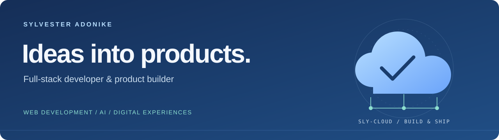

  

  <a href="https://www.skillsnify.com">Skillsnify</a> &nbsp; / &nbsp;
  <a href="https://afiki.uk">Afiki Marketplace</a> &nbsp; / &nbsp;
  <a href="mailto:nnaemekasilver@gmail.com">Let's talk</a>

## Building for everyday use

I'm **Sylvester**, a full-stack developer and product builder. I turn ideas into web experiences that help people learn, connect, and do business.

My work brings together **web development, AI-powered features, and product design** — from the first interface to deployment.

## Selected work

<table>
<tr>
<td width="50%" valign="top">
<h3><a href="https://www.skillsnify.com">Skillsnify ↗</a></h3>

<strong>Learning, with support built in.</strong>

A platform for learners and creators, bringing courses, AI tutoring, communities, and digital products into one experience.

EDUCATION &nbsp; · &nbsp; AI &nbsp; · &nbsp; CREATOR TOOLS

</td>
<td width="50%" valign="top">
<h3><a href="https://afiki.uk">Afiki Marketplace ↗</a></h3>

<strong>A taste of home, delivered.</strong>

A grocery marketplace connecting shoppers with independent African, Asian, and Caribbean stores, with discovery, ordering, and delivery in one place.

COMMERCE &nbsp; · &nbsp; MARKETPLACES &nbsp; · &nbsp; COMMUNITY

</td>
</tr>
</table>

## What I work with

| Focus | Tools & skills |
| :--- | :--- |
| Web development | JavaScript · TypeScript · HTML · CSS |
| Platforms & publishing | WordPress · Joomla |
| Delivery | AWS · Git · GitHub · AI-assisted development |

I care about thoughtful interfaces, practical features, and getting useful products into people's hands.

---

**Have an idea worth building?** [Let's talk →](mailto:nnaemekasilver@gmail.com)
